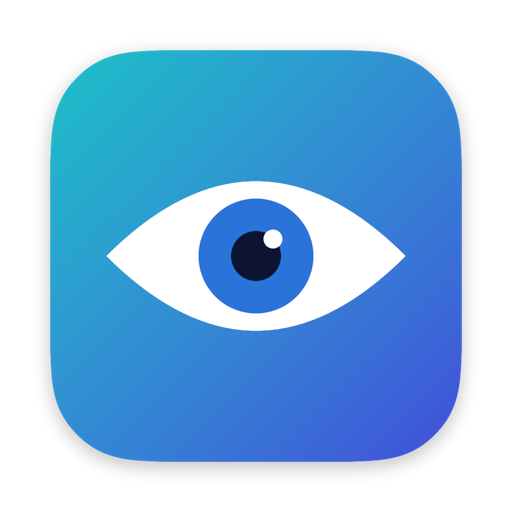
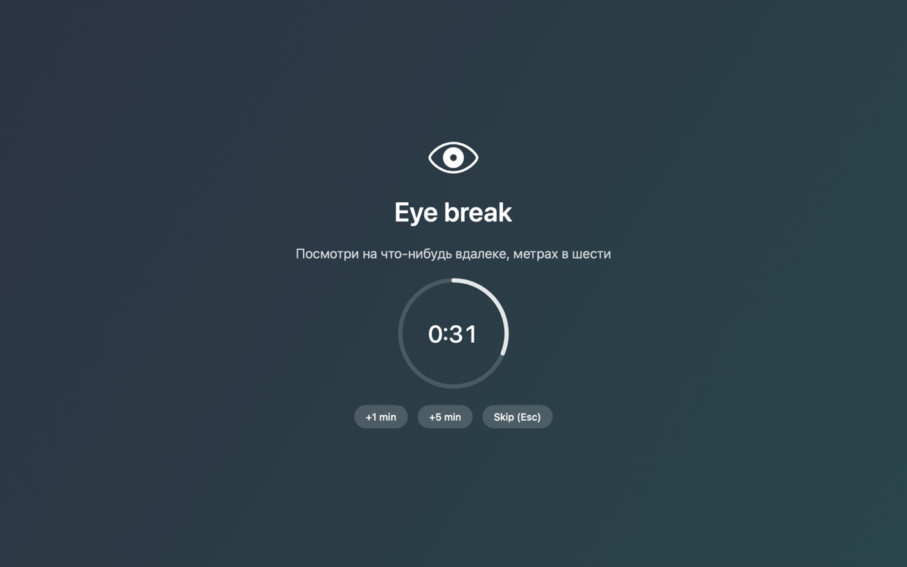
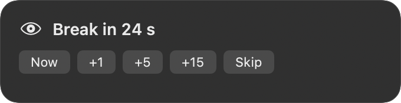
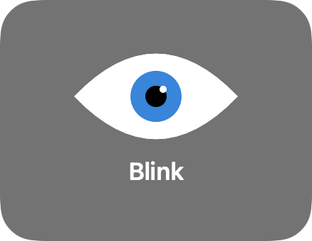
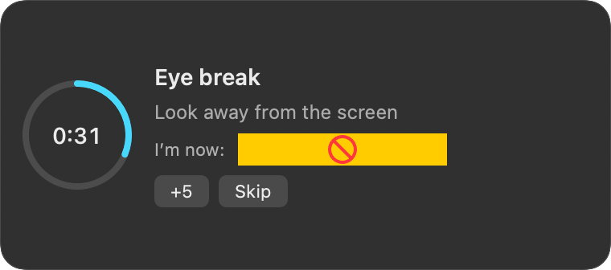
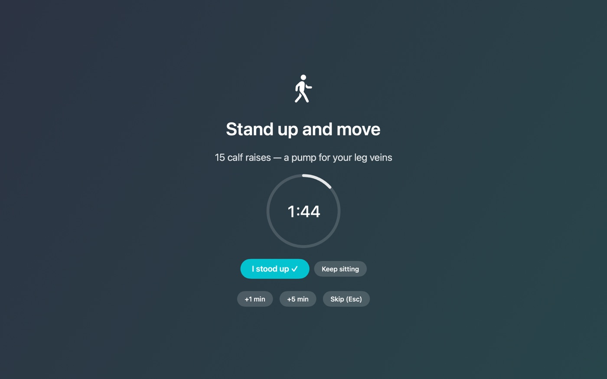
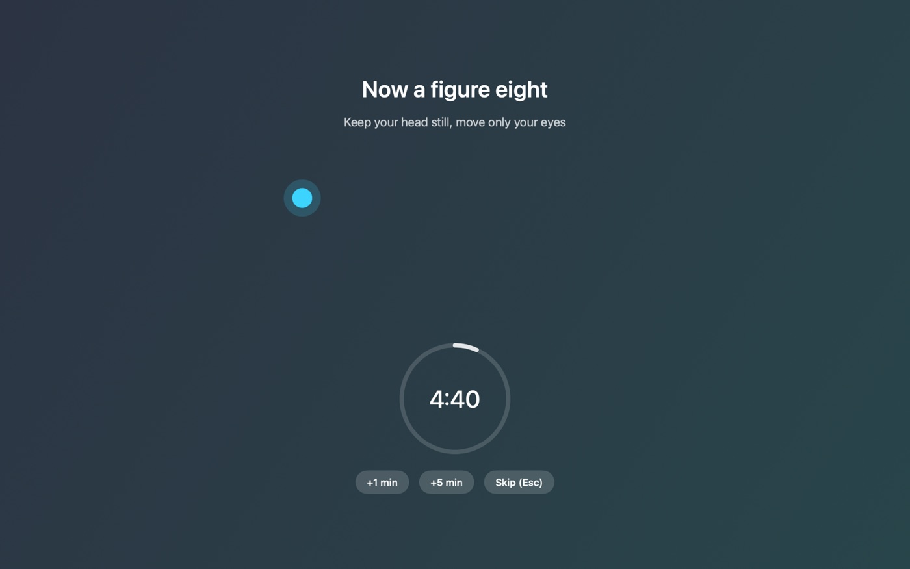
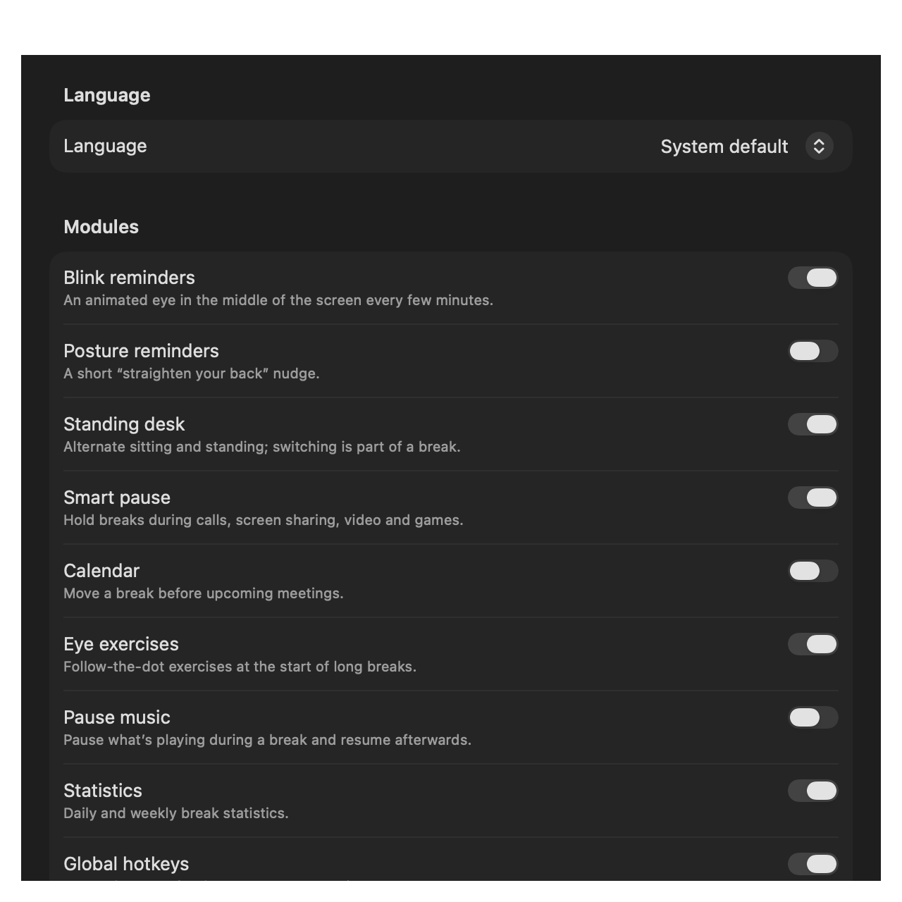
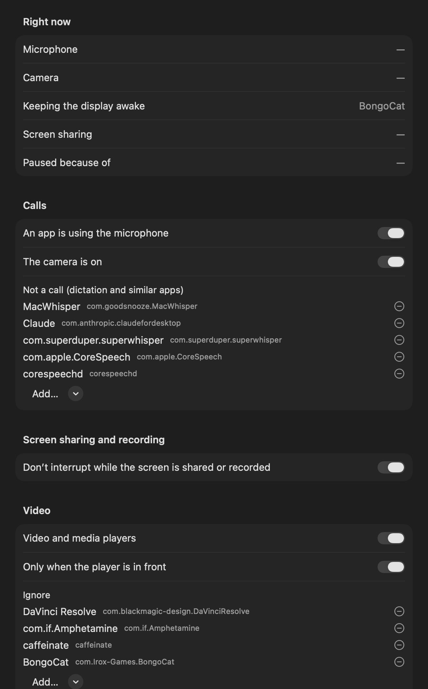

<p align="center">
  
</p>

<h1 align="center">Blinky</h1>

<p align="center">
  A native macOS break reminder that knows when <b>not</b> to interrupt.<br>
  Eye breaks, blink reminders, a standing-desk rhythm — and silence during your calls.
</p>

<p align="center">
  <a href="README.ru.md">Русский</a> ·
  <a href="#install">Install</a> ·
  <a href="#features">Features</a> ·
  <a href="#privacy">Privacy</a> ·
  <a href="CONTRIBUTING.md">Contributing</a>
</p>

<p align="center">
  
</p>

## Why

Most break timers interrupt you in the middle of a call, a demo or a game, and you end up turning them off.
Blinky watches what you are doing and waits: it holds the break while the microphone or camera is busy,
while the screen is shared, while a video plays or a game is in full screen — then gives you a heads-up
and takes the break when you are free.

It is a small native app (Swift + SwiftUI, ~2.5k lines, no dependencies), lives in the menu bar
and uses close to zero CPU.

## Features

**Breaks**
- Short eye breaks (20-20-20 by default) and long breaks every N short ones.
- Full-screen break on every display with blur, or a gentle card in the corner that doesn’t block you.
- Heads-up before each break with *Now / +1 / +5 / +15 / Skip*; waits for a pause in your typing.
- Snooze limit per day, strict mode, custom message, start and end sounds, wallpaper or custom background.
- Eye exercises (follow the dot) at the start of long breaks.

**Reminders**
- Animated blink reminder in the middle of the screen, or a soft glow around the edges. Click-through, never steals focus.
- Optional posture nudge.

**Smart pause**
- **Calls** — detects *which app* is using the microphone (per process, CoreAudio) or whether the camera is on.
  Dictation apps (MacWhisper, Superwhisper, “Hey Siri”…) can be excluded.
- **Screen sharing and recording.**
- **Video** — apps that keep the display awake, optionally only when the player is in front.
- **Full-screen games** and your own list of focus apps (full screen / in front / just open).
- **Away from the Mac** — idle, lid closed or asleep counts as a natural break.
- **Calendar** (optional) — takes the break a bit early if a meeting is about to start.
- **Focus / quiet mode** — gentle breaks while a Focus is on (or via a Shortcuts automation).

**Standing desk** (optional)
- Stand up after 30 min sitting, sit down after 20 min standing (configurable).
- Switching posture *is* the break: two minutes of movement with a concrete exercise,
  confirmed with one click — *I stood up ✓* — and merged with the nearest eye break.

**And**
- Working hours and days, pause for 30 min / 1 h / 2 h / until tomorrow.
- Daily and weekly statistics: breaks taken, skipped, screen time, standing time, good-day streak.
- Global hotkeys (⌃⌥⌘B / P / S / M / Q / U) and a `blinky://` URL scheme for Shortcuts.
- Optional: pause music during a break, run a shortcut at the start and end.
- **Modules**: everything above can be turned off; disabled modules disappear from the menu and settings.
- English and Russian; more languages are a single file away (see [Contributing](CONTRIBUTING.md#translations)).

<p align="center">
  
  
  
</p>
<p align="center">
  
  
</p>
<p align="center">
  
  
</p>

## Install

Requires **macOS 14.4 or later** (Apple Silicon or Intel).

1. Download `Blinky-<version>.zip` from [Releases](https://github.com/AsmodaiP/blinky/releases) and unzip it.
2. Move **Blinky.app** to `/Applications`.
3. The app is ad-hoc signed (not notarized by Apple), so on first launch macOS will block it.
   Either right-click → **Open** → **Open**, or run:

   ```bash
   xattr -dr com.apple.quarantine /Applications/Blinky.app
   ```

4. Look for the 👁 icon in the menu bar. If you don’t see it, macOS may have hidden it:
   **System Settings → Menu Bar** → allow Blinky.

### Build from source

Only the Command Line Tools are needed (no Xcode):

```bash
git clone https://github.com/AsmodaiP/blinky.git
cd blinky
./build.sh --install          # builds, installs to ~/Applications and launches
```

`./build.sh --zip` builds a universal (arm64 + x86_64) app and packs a release zip.

## Usage

Everything is in the menu bar menu: next break, *Break now*, *Snooze 15 minutes*, *Skip next*,
*I’m in a call*, *Quiet mode*, *Pause*, and *Settings…*.

| Hotkey | Action |
|---|---|
| ⌃⌥⌘B | Break now |
| ⌃⌥⌘P | Pause 30 min / resume |
| ⌃⌥⌘S | Snooze 15 min |
| ⌃⌥⌘M | “I’m in a call” on / off |
| ⌃⌥⌘Q | Quiet mode on / off |
| ⌃⌥⌘U | Stood up / sat down (standing desk) |

### URL scheme

Use these from Shortcuts, Raycast, Alfred, or `open` in a terminal:

```text
blinky://break               break now
blinky://pause?min=30        pause
blinky://resume              resume
blinky://snooze?min=15       snooze
blinky://quiet/on | off      quiet mode (gentle breaks)
blinky://meeting/on | off    “I’m in a call”
blinky://stand | sit         confirm posture
```

Example: a Shortcuts **Focus automation** “When Work Focus turns on → Open URL `blinky://quiet/on`”.

## Privacy

- **No network access, no analytics, no accounts.** Settings and statistics stay in `UserDefaults` on your Mac.
- Blinky **never records** audio or video. It only asks macOS *whether* the microphone or camera is in use
  and by which process — this needs no permission.
- **Calendar** access is requested only if you enable the Calendar module; only start/end times,
  titles and attendee counts of today’s events are read, in memory.
- Some detectors use private macOS APIs because there is no public alternative:
  `SLSIsScreenWatcherPresent` (screen sharing), `MRMediaRemoteSendCommand` (pause music),
  `responsibility_get_pid_responsible_for_pid` (attribute WebKit helpers to their app).
  They may change between macOS versions; each one fails safely.

## Troubleshooting

- **A dictation app counts as a call.** Settings → Smart Pause → *Right now* shows who uses the microphone;
  add it to *Not a call* with one click.
- **Breaks never come while I watch videos in the background.** Turn on *Only when the player is in front*.
- **Debug output:** `Blinky.app/Contents/MacOS/Blinky --dump` prints what the detectors see right now.

## Acknowledgements

Inspired by [LookAway](https://lookaway.com) (closed source) and [Stretchly](https://github.com/hovancik/stretchly).
Blinky shares no code with either.

## License

[GPL-3.0](LICENSE) © Blinky contributors.
