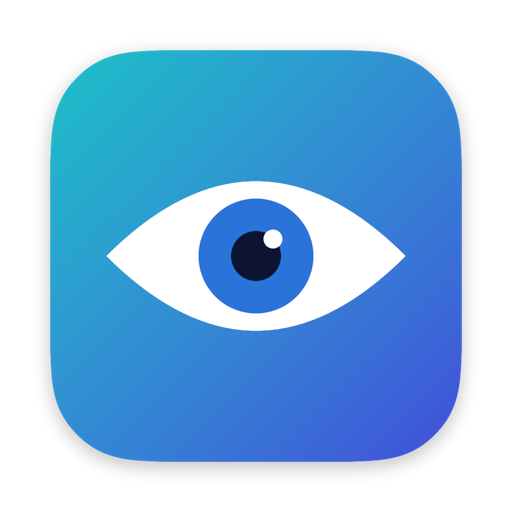
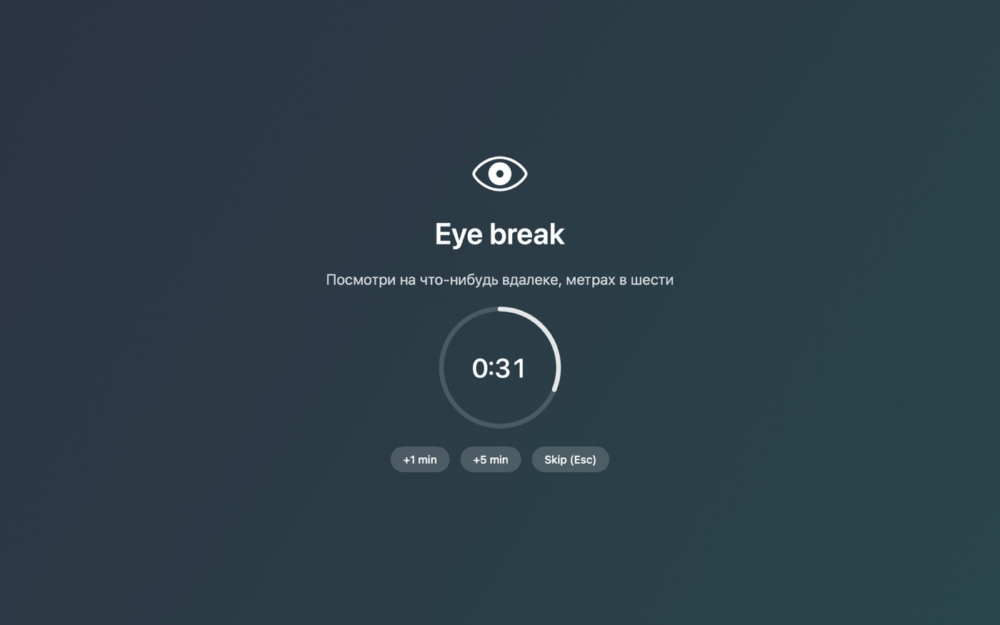

<p align="center">
  
</p>

<h1 align="center">Blinky</h1>

<p align="center">
  Нативное macOS-приложение для перерывов, которое знает, когда <b>не</b> надо мешать.<br>
  Перерывы для глаз, напоминания моргать, ритм стола сидя/стоя — и тишина во время созвонов.
</p>

<p align="center">
  <a href="README.md">English</a> ·
  <a href="#установка">Установка</a> ·
  <a href="#возможности">Возможности</a> ·
  <a href="#приватность">Приватность</a>
</p>

<p align="center">
  
</p>

## Зачем

Обычные таймеры перерывов врываются посреди созвона, демо или игры, и их в итоге выключают.
Blinky смотрит, чем ты занят, и ждёт: не прерывает, пока занят микрофон или камера, показывается экран,
идёт видео или игра на весь экран. Потом предупреждает и делает перерыв, когда ты освободился.

Маленькое нативное приложение (Swift + SwiftUI, без зависимостей), живёт в строке меню
и почти не тратит CPU.

## Возможности

**Перерывы**
- Короткие перерывы для глаз (по умолчанию 20-20-20) и длинные — каждый N-й.
- На весь экран на всех мониторах или мягкая карточка в углу, которая не мешает работать.
- Предупреждение перед перерывом: *Сейчас / +1 / +5 / +15 / Пропустить*; ждёт паузы в наборе текста.
- Лимит откладываний в день, строгий режим, свой текст, звуки, обои или своя картинка на фоне.
- Упражнения для глаз (следить за точкой) в начале длинного перерыва.

**Напоминания**
- Анимированный глаз «Моргни» в центре экрана или мягкое свечение по краю. Не мешает кликать и не забирает фокус.
- Напоминание про осанку по желанию.

**Умная пауза**
- **Созвоны** — определяет, *какое приложение* держит микрофон (по процессам, CoreAudio), и включена ли камера.
  Диктовку (MacWhisper, Superwhisper, «Привет, Siri») можно исключить.
- **Показ и запись экрана.**
- **Видео** — приложения, которые не дают гасить экран; по желанию только если плеер на переднем плане.
- **Игры на весь экран** и свой список приложений для работы.
- **Отошёл от компьютера** — простой, закрытая крышка или сон засчитываются как перерыв.
- **Календарь** (по желанию) — перерыв пораньше перед встречей.
- **Фокус / тихий режим** — мягкие перерывы, пока включён режим Фокуса.

**Стол сидя / стоя** (по желанию)
- Встать через 30 минут сидя, сесть через 20 минут стоя (настраивается).
- Смена позы и есть перерыв: две минуты движения с конкретным упражнением, подтверждение одной кнопкой
  «Встал ✓», объединяется с ближайшим перерывом для глаз.

**А ещё**
- Рабочие часы и дни, пауза на 30 мин / 1 ч / 2 ч / до завтра.
- Статистика за день и неделю: перерывы, пропуски, время за экраном и стоя, серия хороших дней.
- Глобальные горячие клавиши (⌃⌥⌘B / P / S / M / Q / U) и URL-схема `blinky://` для «Команд».
- По желанию: пауза музыки на перерыве, запуск команды в начале и в конце.
- **Модули**: всё перечисленное можно выключить, выключенное пропадает из меню и настроек.
- Английский и русский интерфейс.

## Установка

Нужна **macOS 14.4 или новее** (Apple Silicon или Intel).

1. Скачай `Blinky-<версия>.zip` в [Releases](https://github.com/AsmodaiP/blinky/releases) и распакуй.
2. Перенеси **Blinky.app** в `/Applications`.
3. Приложение подписано ad-hoc (без нотаризации Apple), поэтому при первом запуске macOS его заблокирует.
   Кликни правой кнопкой → **Открыть** → **Открыть** или выполни:

   ```bash
   xattr -dr com.apple.quarantine /Applications/Blinky.app
   ```

4. Ищи значок 👁 в строке меню. Если его нет, macOS могла его скрыть:
   **Системные настройки → Строка меню** → разрешить Blinky.

### Сборка из исходников

Достаточно Command Line Tools (Xcode не нужен):

```bash
git clone https://github.com/AsmodaiP/blinky.git
cd blinky
./build.sh --install
```

## Приватность

- **Никакой сети, аналитики и аккаунтов.** Настройки и статистика хранятся в `UserDefaults` на твоём Mac.
- Blinky **ничего не записывает** — только спрашивает у macOS, *занят ли* микрофон или камера и каким процессом.
  Для этого не нужны разрешения.
- Доступ к **Календарю** запрашивается, только если включить модуль «Календарь».
- Часть детекторов использует закрытые API macOS, потому что публичных нет: показ экрана, пауза музыки,
  определение приложения по служебному процессу WebKit. При изменениях в macOS они безопасно отключаются.

Подробнее — в [английском README](README.md).

## Лицензия

[GPL-3.0](LICENSE).
